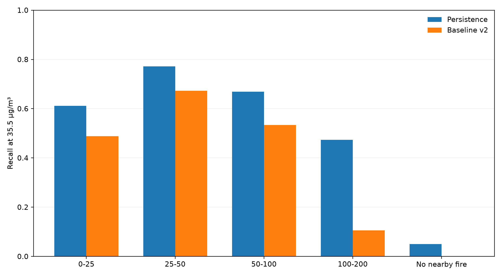
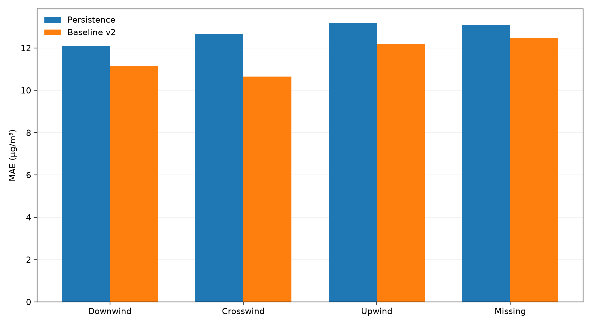
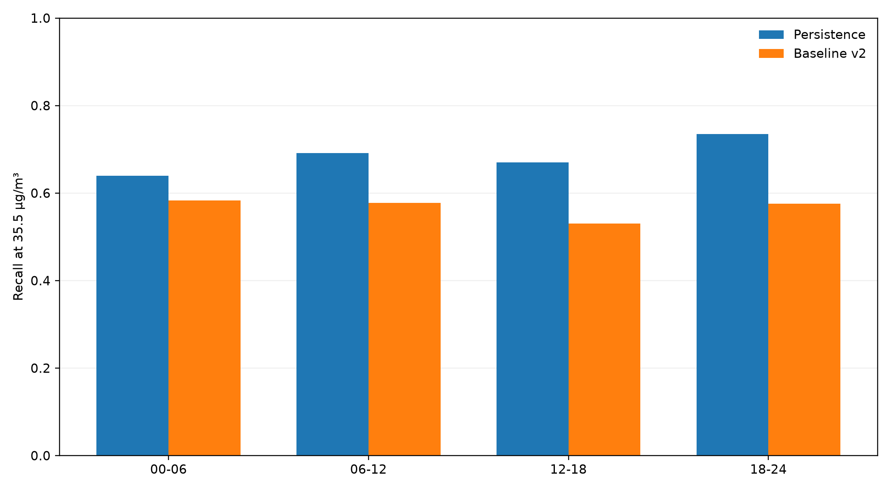
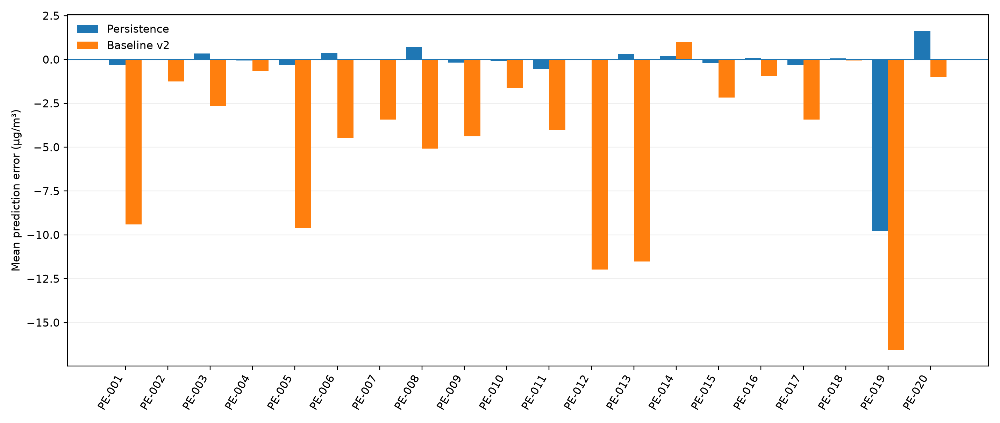
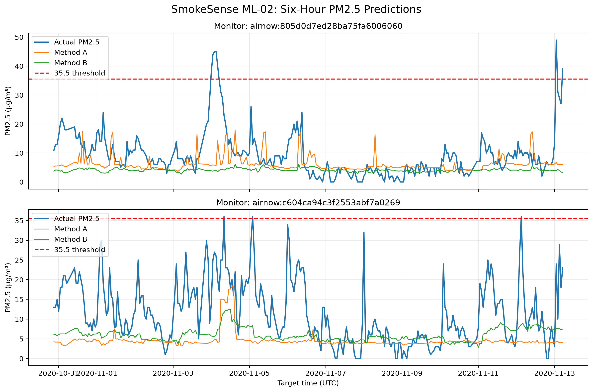

# ML-03: PM2.5 Forecast Error Analysis

## 1. Objective

Evaluate SmokeSense forecasting performance across horizons, wildfire events, and environmental conditions.

The analysis focuses on:

- Regression accuracy: MAE, RMSE, and signed bias.
- Exceedance detection: precision, recall, and F1.
- Environmental conditions: fire distance, wind alignment, and local solar hour.
- Severe-smoke underprediction.
- ML-02 spatial forecasting methods.

The primary evaluation horizon is six hours.

## 2. Data and Methods

### 2.1 Full DATA-04 evaluation

The official DATA-04 v1.0.0 release contains:

- 141,954 historical forecast rows.
- 20 pilot wildfire events.
- 13 cross-validation groups.
- Forecast horizons of 1, 3, 6, 12, and 24 hours.

This report uses the released baseline-v2 out-of-fold predictions, not newly trained models.

The paired evaluation retains rows with valid observed PM2.5, persistence predictions, and baseline-v2 predictions, resulting in 139,020 rows.

The six-hour subset contains 27,824 paired rows.

### 2.2 Evaluation metrics

Regression metrics:

- MAE: mean absolute error.
- RMSE: root mean squared error.
- Bias: mean(prediction - observation).

Detection metrics:

- Precision.
- Recall.
- F1.

The operational exceedance threshold is 35.5 µg/m³.

This numerical threshold is derived from the EPA 2024 PM2.5 AQI breakpoint for the Unhealthy for Sensitive Groups category. The EPA breakpoint applies to 24-hour PM2.5 concentrations; SmokeSense uses the same numerical threshold for evaluating hourly concentration forecasts. Results must not be interpreted as official hourly AQI classifications.

Severe observations are defined as observed PM2.5 >= 125.5 µg/m³.

### 2.3 Comparison design

Persistence and baseline-v2 metrics are computed on identical valid prediction rows.

Environmental breakdowns use the same paired six-hour subset.

Group-level results are descriptive. Differences between categories do not establish causal relationships.

## 3. Baseline-v2 Versus Persistence

### 3.1 Results across forecasting horizons

| Horizon | Persistence MAE | Baseline-v2 MAE | Persistence F1 | Baseline-v2 F1 |
|---|---:|---:|---:|---:|
| 1h | 7.576 | 8.007 | 0.826 | 0.813 |
| 3h | 10.370 | 9.871 | 0.749 | 0.727 |
| 6h | 12.821 | 11.743 | 0.683 | 0.656 |
| 12h | 15.088 | 13.067 | 0.614 | 0.545 |
| 24h | 15.739 | 14.350 | 0.574 | 0.513 |

MAE is measured in µg/m³.

Baseline_v2 improves MAE at four of the five horizons, but its F1 is lower than persistence at every horizon.

### 3.2 Exceedance recall

| Horizon | Persistence recall | Baseline-v2 recall |
|---|---:|---:|
| 1h | 0.826 | 0.761 |
| 3h | 0.748 | 0.648 |
| 6h | 0.682 | 0.567 |
| 12h | 0.612 | 0.426 |
| 24h | 0.571 | 0.411 |

Baseline_v2 has higher precision than persistence at every horizon, but lower recall.

At six hours, baseline_v2 reduces MAE by approximately 8.4% on the paired evaluation rows while reducing recall by approximately 11.5 percentage points.

This demonstrates that improved average concentration prediction does not necessarily imply improved fixed-threshold exceedance detection.

## 4. Severe-Smoke Underprediction

For six-hour forecasts with observed PM2.5 >= 125.5 µg/m³:

- Severe observations: 648.
- Events represented: 14.
- Mean observed concentration: 221.73 µg/m³.
- Mean persistence prediction: 159.66 µg/m³.
- Mean baseline-v2 prediction: 94.53 µg/m³.
- Persistence bias: -62.07 µg/m³.
- Baseline-v2 bias: -127.19 µg/m³.
- Baseline-v2 underprediction rate: 95.99%.

Baseline_v2 substantially underpredicts concentrations within the severe-observation subset.

All 14 represented events exhibit negative mean baseline-v2 bias within that subset.

The three events with the largest severe-observation counts are:

| Event | Severe observations | Baseline-v2 bias | Persistence bias |
|---|---:|---:|---:|
| PE-012 | 283 | -145.67 | -33.83 |
| PE-001 | 154 | -108.86 | -73.95 |
| PE-005 | 81 | -101.73 | -75.21 |

These three events contribute 518 of 648 severe observations, or approximately 79.9%.

The underprediction rate is conditional on selecting severe observations. It is not the underprediction rate across all forecasts.

Consecutive observations may also be temporally correlated.

## 5. Environmental Error Analysis

All results in this section use 27,824 paired six-hour forecasts across 20 events.

### 5.1 Distance to wildfire

| Distance | Baseline-v2 MAE | Baseline-v2 recall | Persistence recall |
|---|---:|---:|---:|
| 0-25 km | 13.02 | 0.489 | 0.611 |
| 25-50 km | 10.97 | 0.672 | 0.772 |
| 50-100 km | 10.11 | 0.533 | 0.669 |
| 100-200 km | 5.67 | 0.105 | 0.474 |
| No nearby fire | 7.40 | 0.000 | 0.050 |

Within 25 km of a fire, baseline_v2 has MAE of 13.02 µg/m³ and recall of 48.9%.

The 100-200 km and no-nearby-fire categories contain only 19 and 20 observed exceedances, respectively. Their recall estimates are less stable.

### 5.2 Wind alignment

| Wind category | Baseline-v2 MAE | Baseline-v2 bias | Baseline-v2 recall |
|---|---:|---:|---:|
| Crosswind | 10.65 | -3.97 | 0.575 |
| Downwind | 11.17 | -5.68 | 0.552 |
| Upwind | 12.20 | -5.52 | 0.576 |
| Missing | 12.47 | -6.51 | 0.566 |

The full dataset contains 50,343 missing wind-alignment values.

The paired six-hour subset includes 9,883 rows with missing wind alignment.

Missing values are retained as a distinct category rather than interpreted as a specific wind condition.

Negative baseline-v2 bias occurs in every wind category.

### 5.3 Local solar hour

| Issue-time group | Baseline-v2 MAE | Baseline-v2 recall |
|---|---:|---:|
| 00-06 | 12.93 | 0.583 |
| 06-12 | 12.27 | 0.578 |
| 12-18 | 11.47 | 0.531 |
| 18-24 | 10.32 | 0.576 |

The 12-18 group has the lowest baseline-v2 recall.

The time categories represent the local solar hour at forecast issue time, rather than forecast target time.

### 5.4 Event-level comparison

PE-012 is particularly notable:

| Metric | Persistence | Baseline v2 |
|---|---:|---:|
| MAE | 17.14 | 17.68 |
| Recall | 0.721 | 0.569 |
| Bias | -0.01 | -11.97 |

For this event, baseline_v2 performs worse than persistence on both MAE and exceedance recall.

Event-level differences suggest that pooled evaluation metrics can conceal important variability.

## 6. ML-02 Spatial Forecasting Comparison

ML-02 compared two approaches:

**Method A:** Train predictive models at monitoring stations using observed PM2.5 histories, then interpolate forecasts spatially.

**Method B:** Interpolate historical PM2.5 features using leave-one-monitor-out inverse-distance weighting (IDW), then train and predict at target locations.

The paired PE-001 experiment contains 3,044 predictions across all five forecast horizons.

At the six-hour horizon:

| Metric | Method A | Method B |
|---|---:|---:|
| MAE | 6.494 | 6.443 |
| RMSE | 9.521 | 9.409 |
| Bias | -5.053 | -5.395 |

There were 608 paired six-hour predictions, including 10 observed exceedances of 35.5 µg/m³.

Neither method predicted an exceedance, giving both methods zero recall and zero F1. Precision is undefined because neither issued a positive prediction.

The PE-001 spatial experiment involved only two monitoring stations, leaving one neighbor for interpolation in each leave-one-monitor-out case.

These results do not establish general spatial generalization.

The ML-02 experiment and full baseline-v2 evaluation use different experimental settings and prediction populations. Their metrics should not be treated as direct model rankings.

## 7. Main Findings

1. **Regression accuracy and exceedance detection diverge.** Baseline_v2 reduces MAE at four of five horizons but has lower F1 and recall than persistence at every horizon.

2. **Severe-smoke underprediction is substantial.** For 648 severe six-hour observations across 14 events, baseline_v2 has a mean bias of -127.19 µg/m³ and underpredicts 95.99% of observations.

3. **Environmental performance is heterogeneous.** Fire-distance, wind-alignment, and time-of-day groups exhibit different error and detection patterns. These associations are descriptive, not causal.

4. **Event-level performance matters.** PE-012 is a notable example where baseline_v2 performs worse than persistence on both MAE and recall.

5. **Limited spatial monitoring constrains ML-02 interpretation.** The two-monitor PE-001 experiment provides useful diagnostic evidence but is insufficient for broad spatial-generalization claims.

## 8. Limitations

- Out-of-fold predictions follow the released DATA-04 cross-validation design; they do not establish independent deployment performance.
- The 35.5 µg/m³ threshold is borrowed from a 24-hour AQI breakpoint and applied numerically to hourly concentrations.
- Severe-observation analysis conditions on the observed outcome.
- Forecast observations may be correlated within events and over time.
- Environmental groups have unequal sample sizes and exceedance prevalence.
- Wind-alignment data are missing for a substantial fraction of forecasts.
- Observed associations cannot establish why model errors occur.
- The spatial ML-02 experiment is restricted to one event with two monitors.
- Metrics from different evaluation populations should not be directly compared.

## 9. Recommended Next Experiments

Potential follow-up experiments include:

- Analyze the precision-recall tradeoff under alternative prediction thresholds.
- Examine model calibration separately from fixed-threshold detection performance.
- Evaluate errors during rapid increases in PM2.5.
- Test whether training objectives that emphasize high concentrations improve exceedance recall.
- Investigate event-specific failures, particularly PE-012.
- Evaluate spatial methods on additional events and monitoring networks.

These are proposed investigations, not implemented model improvements.

## 10. Reproducibility

Official source:

- DATA-04 v1.0.0 GitHub release.
- Downloaded archives verified against SHA256SUMS.txt.
- Extracted dataset validated against manifest.json.

Primary artifacts:

- `data/release/ml03_extracted/smokesense_v1/data.parquet`
- `data/release/ml03_extracted/baseline_v2/oof_predictions.parquet`

ML-03 scripts:

- `ml/evaluation/error_analysis.py`
- `scripts/run_ml03_environmental.py`
- `scripts/plot_ml03_full.py`

Generated environmental reports:

- `data/release/ml03_analysis/`

Figures:

- `docs/ml/figures/ml03_distance_recall.png`
- `docs/ml/figures/ml03_wind_mae.png`
- `docs/ml/figures/ml03_time_recall.png`
- `docs/ml/figures/ml03_event_bias.png`
- `docs/ml/figures/ml02_six_hour_predictions.png`

Validation:

- Six ML-03 unit tests passed.
- Environmental analysis script completed successfully.
- Ruff checks passed for the analysis and plotting scripts.
